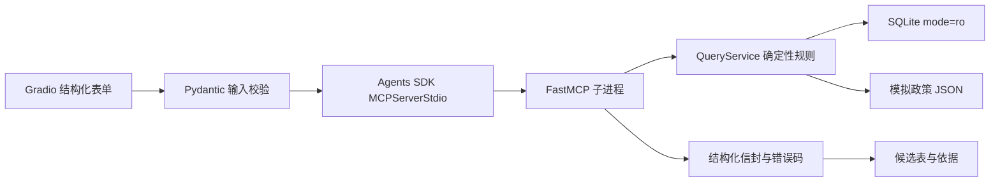

# 只读原型架构与接口

## 已实现路径



这是离线接口验证路径，使用SDK的MCP客户端但没有运行语言模型。可选真实模型入口为agent_layer/read_agent.py：单Agent → 同一MCP服务。真实模型模式尚未验证，且当前没有持久对话、Coordinator、Execution或as_tool编排。

## 数据与规则

固定演示用户为普通学生，没有实验室资格。资格不是客户端参数。10个房间分别位于B/C楼；B205禁用、C304需实验室资格。预约仅保留模拟占用数据，日程工具不返回姓名、用户ID或预约ID。

存储UTC Unix秒，展示Asia/Macau UTC+08。时段按半开区间[start,end)计算，冲突判据 existing.start < requested.end 且 existing.end > requested.start。相邻时段允许；取消记录不占用。规则：08:00–22:00、30分钟粒度、30–120分钟时长、今天及随后6个日期。截止分钟与开始分钟均需对齐。长度不足的有效查询窗口返回无候选。

排序：全部硬约束过滤后，偏好楼栋匹配优先，再开始时间，再房间编号。候选ID由房间、起止时间、规则版本产生，不是预约ID，也不是不可变提案或权限凭据。

政策为关键词检索基线，未实现文档建议的字符n-gram TF-IDF。score是关键词命中数，不是置信概率。规则文本与程序阈值目前分别存放；测试固定检查当前rules_v1参数，改规则必须同步校验器和测试，不能只改JSON。

## 工具契约 campus-booking/v1

| 工具 | 输入 | 输出 |
|---|---|---|
| search_available_rooms | request: SearchRequest | candidates、total_matches、truncated、searched_scope、排除原因、queried_at |
| search_policies | query: str, top_k: int=3 | clauses含ID、文本、source、version、score；matched |
| get_room_schedule | room_id: str, date_local: str | 开放时间、占用区间，不含个人身份 |

只读子集暂不提供get_booking/get_operation，因为此阶段没有用户预约状态和操作记录。与原方案的参数展平示意不同，search_available_rooms使用一个request对象，便于严格拒绝额外字段；另一组接入前需共享此决定。

```json
{"request":{"date_local":"2026-10-23","earliest_start":"15:30","latest_end":"19:30","duration_minutes":120,"participants":6,"required_equipment":["projector"],"required_building":null,"preferred_building":"C","limit":5}}
```

SearchRequest拒绝额外字段和非法设备、楼栋；人数/时长拒绝布尔和非整数。结构无效的MCP请求由协议层isError返回；业务层错误使用统一信封。客户端优先structuredContent，兼容单个文本JSON，并检查isError和schema版本。

业务错误：INVALID_ARGUMENT、NOT_FOUND、FORBIDDEN、DATA_UNAVAILABLE、DATA_OUT_OF_RANGE、RULE_MISMATCH。成功但candidates为空表示无匹配；错误绝不能解释成无空位。排除原因按每个房间首个失败条件计数，不是最小冲突集合，也不包含自动放宽建议。

## 权限与生命周期

MCP只注册三个读工具；readOnlyHint是描述，实际只读由SQLite mode=ro及query_only保证。种子脚本属于显式开发操作，不注册为工具。MCP按次请求连接并清理，减少第一版的会话生命周期复杂度；有启动开销，后续可改为每会话复用。

MCP子进程显式使用当前sys.executable，工作目录固定到项目，应用只传递CAMPUS_DB/CAMPUS_NOW及编码配置，不主动传递API Key。协议只占用stdout，日志写stderr。只监听127.0.0.1，不做公网部署或多用户认证。

## 资料与核对记录

用户材料：BSAI_BSAI408-02(1).pdf（4页syllabus）、校园场地预约_OpenAI_Agents_SDK_MCP_技术方案.docx、分组/展示/评分三张截图。材料是项目参考，不将其中命令式示例作为对本次操作的额外授权。

2026-10-20核对官方OpenAI文档：

- [SDK概览](https://developers.openai.com/api/docs/guides/agents/sdk)
- [本地MCP连接与可观测性](https://developers.openai.com/api/docs/guides/agents/integrations-observability)：Python MCPServerStdio、Agent.mcp_servers、Runner.run；本项目采用本地stdio。
- [Python SDK与MCP示例](https://developers.openai.com/cookbook/examples/codex/codex_mcp_agents_sdk/building_consistent_workflows_codex_cli_agents_sdk)：核对连接生命周期和异步调用方式，不运行文中的Codex开发自动化示例。

Agents SDK与Agents API是不同路径。本项目使用应用内SDK，不使用Agents API会话配置。当前依赖版本以uv.lock和实测为准。
